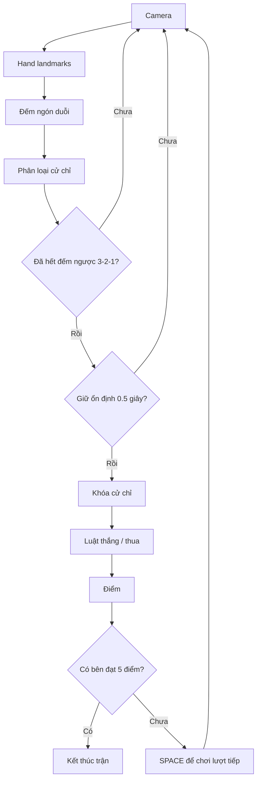

# Rock–Paper–Scissors với MediaPipe Hand

- Game kéo–búa–bao thi đấu với máy, **ai đạt 5 điểm trước thắng trận**.
- Python + OpenCV hiển thị webcam; MediaPipe chỉ lấy 21 landmarks.
- Thuật toán đếm ngón, phân loại cử chỉ, chống nhiễu và luật chơi nằm trong code Python của project.

## Sơ đồ xử lý



## Cài đặt và chạy
Yêu cầu: Dùng **Python 3.12**, webcam và máy tính có giao diện desktop.

Chạy **lần đầu**:

Windows:
```powershell
winget install Python.Python.3.12
# đóng và mở lại PowerShell
py -3.12 -m venv .venv
Set-ExecutionPolicy -Scope Process Bypass
.venv\Scripts\Activate.ps1
python -m pip install -r requirements.txt
python main.py
```
macOS / Linux:

```bash
# macOS
brew install python@3.12
# Ubuntu/Debian/Kali
sudo apt install python3.12 python3.12-venv

python3.12 -m venv .venv
source .venv/bin/activate
python -m pip install -r requirements.txt
python main.py
```

Chạy chương trình **những lần sau** (đã cài xong, chỉ cần kích hoạt lại môi trường ảo):

Windows:
```powershell
Set-ExecutionPolicy -Scope Process Bypass
.venv\Scripts\Activate.ps1
python main.py
```

macOS / Linux:
```bash
source .venv/bin/activate
python main.py
```

- Không cần tải model mỗi lần chạy
- Không cài thêm OpenCV headless.

## Hướng dẫn chơi

Nếu không mở được camera, thử `python main.py --camera 1`.

1. Đưa **một bàn tay** vào camera, giữ rõ cả bàn tay, tránh che các ngón.
2. Bấm **SPACE**: máy chọn ngẫu nhiên trước(chắc chắn là ngẫu nhiên...), nhưng chưa hiện lựa chọn.
3. Giữ cử chỉ hợp lệ.
4. Game khóa hai lựa chọn, công bố kết quả và cộng điểm.
5. Bấm SPACE để bắt đầu lượt tiếp. Ai chạm **5 điểm** thắng trận.

| Cử chỉ | Quy ước nhận diện |
|---|---|
| ROCK — Búa | Cả 4 ngón trỏ, giữa, áp út, út đều co |
| PAPER — Bao | Cả 4 ngón trên đều duỗi |
| SCISSORS — Kéo | Chỉ ngón trỏ và giữa duỗi |
| Khác / mất tay / có 2 tay được phát hiện | Không khóa, bắt đầu lại thời gian ổn định |

**Ngón cái được bỏ qua** để giảm độ phức tạp nên finger chỉ có 4.

Hai ngón bất kỳ không tự động được coi là kéo.

Hòa không cộng điểm; mỗi lượt chỉ cộng điểm một lần.

Không có thời hạn ra tay: game chờ đến khi có cử chỉ ổn định.

| Phím | Tác dụng |
|---|---|
| SPACE | Bắt đầu / lượt tiếp theo; không bỏ qua lượt đang chơi |
| R | Xóa điểm, bắt đầu trận mới |
| Q / Esc | Thoát |

## Cấu trúc repo

```text
rock-paper-scissors/
├── main.py                  # Vòng lặp camera và bàn phím
├── requirements.txt
├── README.md
├── .gitignore
├── rps/
│   ├── __init__.py
│   ├── settings.py          # Thời gian, điểm đích, ngưỡng tỉ lệ ngón
│   ├── hand.py              # MediaPipe → landmarks
│   ├── gesture.py           # Tỉ lệ khoảng cách → đếm ngón → cử chỉ
│   ├── game.py              # Countdown, khóa, luật, điểm
│   └── view.py              # Vẽ webcam và thông tin
├── models/
│   ├── hand_landmarker.task
│   └── README.md
├── assets/                  # Chỗ lưu ảnh / video demo thực tế
├── docs/
│   ├── REPORT.md
│   └── TESTING.md           # Check test
```

## Thuật toán ngắn gọn

- Dùng **world landmarks**, chỉ lấy x, y (bỏ độ sâu z vì nhiễu khi úp tay) để tính khoảng cách.
- Mỗi ngón có 4 điểm: gốc, khớp giữa, khớp cuối, đầu ngón.
- Ngón duỗi khi **tỉ lệ khoảng cách đầu ngón–cổ tay / khớp giữa–cổ tay > khoảng 1,08**. Đếm và kiểm tra mẫu ngón để phân loại.
- Sau countdown, lưu cử chỉ và thời điểm bắt đầu. Đủ 0,5 giây liên tục thì khóa.
- Đổi cử chỉ, không hợp lệ hoặc mất tay: đặt lại thời gian. Khoảng cách giữa hai frame > 0,25 giây cũng đặt lại để không khóa bằng dữ liệu cũ.
- Búa thắng kéo, kéo thắng bao, bao thắng búa. Người thắng được 1 điểm.

Ngưỡng tỉ lệ là heuristic cần thử trên webcam thật. Cầm đồ vật, xoay tay quá nghiêng, các ngón co một phần hoặc bị che có thể bị phân loại sai. 0,5 giây chống dao động ngắn, không bảo đảm nhận diện đúng mọi tư thế. Nếu xử lý chậm dưới khoảng 4 FPS, cần giảm tải hoặc điều chỉnh `MAX_FRAME_GAP` có cân nhắc.

## Video demo

[Video_demo](https://drive.google.com/file/d/1Q9CguJaCwOu7wg9J7Txcl5DDp5UM5QI6/view?usp=sharing)


## Tham khảo

- [MediaPipe Hand Landmarker Python](https://ai.google.dev/edge/mediapipe/solutions/vision/hand_landmarker/python): API VIDEO, landmarks và timestamp tăng dần.
- [Model chính thức](https://storage.googleapis.com/mediapipe-models/hand_landmarker/hand_landmarker/float16/latest/hand_landmarker.task).

### Lỗi môi trường thường gặp

- Linux báo thiếu `libGLESv2.so.2`: cài thư viện hệ thống `libgles2` (Ubuntu/Debian), ví dụ `sudo apt install libgles2`.
- Không mở được webcam: đóng ứng dụng khác đang dùng camera, bật quyền camera hoặc thử `--camera 1`.
- Cửa sổ không mở trên server/headless: chạy trên desktop có màn hình, không dùng `opencv-python-headless`.
- Các thư viện được cài thành công và 12 manual tests đã đạt; đã chạy thực tế với webcam trên Windows.