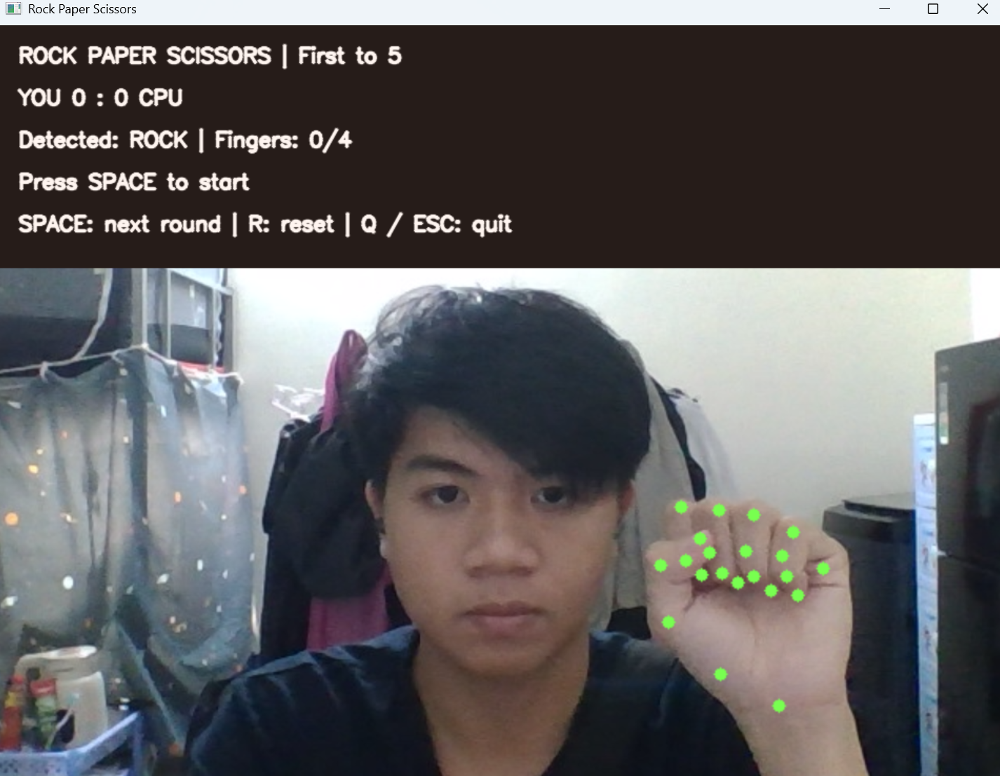
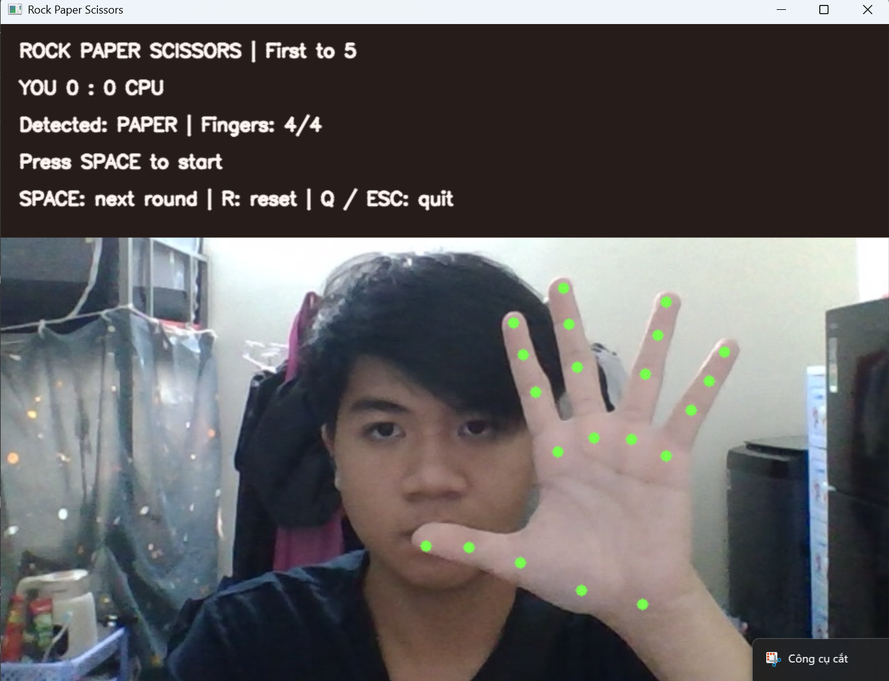
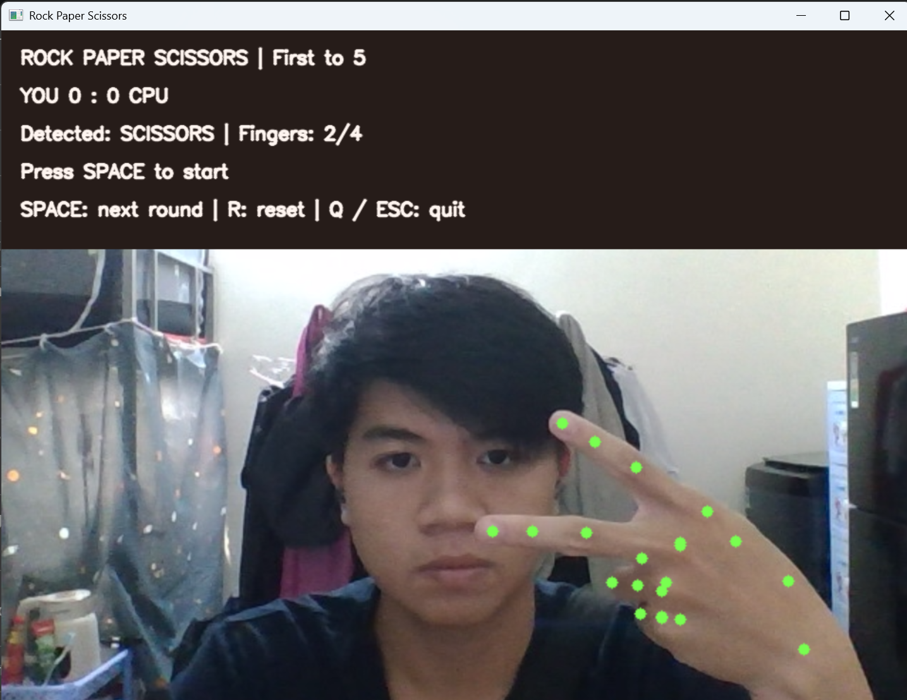
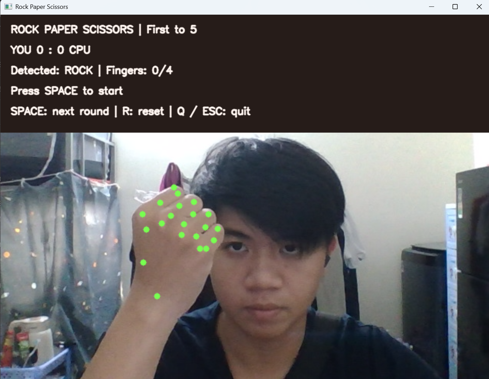
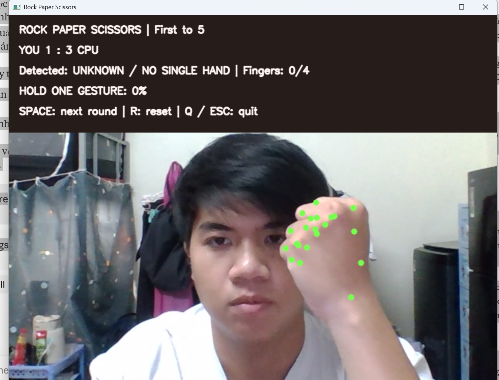

# Báo cáo: Kéo–búa–bao bằng cử chỉ tay
## 0. Link video demo
[Video_demo](https://drive.google.com/file/d/1Q9CguJaCwOu7wg9J7Txcl5DDp5UM5QI6/view?usp=sharing)
## 1. Ý tưởng, input và output
 
- Người chơi chơi trò kéo búa bao đấu với máy bằng tay trước webcam. Luật kéo búa báo theo luật tiêu chuẩn gồm 3 loại là kéo, búa và bao. 
- Input là các frame camera.
- Output là cử chỉ, tiến trình giữ tay, kết quả lượt, điểm và bên thắng trận.
- Người chơi đạt 5 điểm trước máy sẽ thắng, ngược lại máy sẽ thắng. 
## 2. Vai trò MediaPipe
 
Hand Landmarker phát hiện 21 điểm bàn tay. `hand_landmarks` dùng để vẽ điểm lên ảnh; `hand_world_landmarks` cung cấp tọa độ thế giới; project chỉ dùng $x$, $y$ để tính tỉ lệ khoảng cách. Chạy chế độ VIDEO với timestamp mili giây tăng dần. Project không dùng Gesture Recognizer để phân loại búa/bao/kéo.
 
### Dữ liệu MediaPipe cung cấp
 
Với mỗi bàn tay được phát hiện, MediaPipe trả về:
 
- **`hand_landmarks`**: 21 điểm có tọa độ $x$, $y$ chuẩn hóa trong khoảng $[0, 1]$ theo kích thước ảnh. Project dùng để vẽ các chấm xanh lên khung hình.
- **`hand_world_landmarks`**: 21 điểm có tọa độ 3D thật (đơn vị mét), gốc ở tâm bàn tay nên không phụ thuộc vị trí bàn tay trong khung hình. Project dùng để phân loại cử chỉ.
- **Số tay**: cấu hình `num_hands=2` để biết khi có hơn một tay trong khung hình, từ đó từ chối cử chỉ.
Các điểm được đánh số: 0 là cổ tay, 1–4 ngón cái, 5–8 ngón trỏ, 9–12 ngón giữa, 13–16 ngón áp út, 17–20 ngón út. Trong mỗi ngón, thứ tự là gốc ngón, khớp giữa, khớp cuối, đầu ngón.
 
Model dùng là `hand_landmarker.task` có sẵn của MediaPipe, không tự huấn luyện. MediaPipe chỉ trả về tọa độ, không biết đâu là búa, bao hay kéo; phần đó do thuật toán ở mục 3 đảm nhiệm.
 
## 3. Thuật toán
 
### Đếm ngón và phân loại

**Ý tưởng:** ngón tay duỗi thì đầu ngón ở xa cổ tay, ngón tay co thì đầu ngón gập về gần lòng bàn tay. Dùng sự khác biệt này để biết ngón nào đang duỗi.

**Các điểm được dùng.** Mỗi ngón có 4 điểm do MediaPipe cung cấp. Xét 4 ngón: trỏ (điểm 5–8), giữa (9–12), áp út (13–16) và út (17–20). Ngón cái được bỏ qua vì nó cử động theo hướng khác. Với mỗi ngón, lấy 3 điểm:

- $W$: cổ tay (điểm số 0).
- $B$: khớp giữa của ngón.
- $T$: đầu ngón.

**Bước 1: Tính tỉ lệ $r$.** Lấy khoảng cách từ cổ tay đến đầu ngón chia cho khoảng cách từ cổ tay đến khớp giữa:

$$
r = \frac{|WT|}{|WB|}
$$

Khoảng cách từ cổ tay đến khớp giữa gần như không đổi dù ngón duỗi hay co, nên nó đóng vai trò như một cây thước. Nhờ vậy:

- Ngón duỗi: $r$ lớn hơn 1 (ví dụ $|WB| = 10$, $|WT| = 17$ thì $r = 1{,}7$).
- Ngón co: $r$ nhỏ hơn 1 (ví dụ $|WB| = 10$, $|WT| = 8$ thì $r = 0{,}8$).

Vì $r$ là một phép chia nên tay to hay nhỏ, gần hay xa camera, xoay hay lật gương đều cho cùng kết quả.

**Cách tính khoảng cách.** Dùng công thức Pytago trên tọa độ $x$, $y$:

$$
|WT| = \sqrt{(x_T - x_W)^2 + (y_T - y_W)^2}
$$

Không dùng độ sâu $z$ vì giá trị này nhiễu, nhất là khi úp tay.

**Bước 2: Quy đổi $r$ thành điểm duỗi từ 0 đến 1.**

$$
\text{điểm duỗi} = \operatorname{clamp}\left(\frac{r - 0{,}9}{1{,}25 - 0{,}9},\ 0,\ 1\right)
$$

- $r \le 0{,}9$: điểm bằng $0$ (co hẳn).
- $r \ge 1{,}25$: điểm bằng $1$ (duỗi hẳn).
- Ở giữa: điểm tăng dần từ $0$ đến $1$.

Hàm $\operatorname{clamp}$ chỉ có nhiệm vụ giữ kết quả trong khoảng từ 0 đến 1. Nếu $|WB|$ gần bằng $0$ thì điểm được đặt là $0$ để tránh chia cho 0.

**Bước 3: Kết luận ngón duỗi hay co.** Điểm lớn hơn $0{,}5$ (tương đương $r > 1{,}075$) thì ngón được coi là **duỗi**, ngược lại là **co**.

**Bước 4: Đếm ngón và gọi tên cử chỉ.**

| Các ngón đang duỗi | Cử chỉ |
|---|---|
| Không có ngón nào | Búa |
| Cả 4 ngón | Bao |
| Đúng ngón trỏ và ngón giữa | Kéo |
| Các trường hợp còn lại | Không hợp lệ |

Hai ngón bất kỳ không tự động được coi là kéo, chỉ có cặp trỏ và giữa mới đúng. Đây là quy ước đơn giản phục vụ game. Các tư thế ngoài quy ước, đặc biệt là ngón co chưa hết hoặc bị che, cần được đánh giá thực tế trên webcam.

## 4. Chuyển dữ liệu MediaPipe thành hành động trong game
 
Mỗi vòng lặp của `main.py` xử lý một frame theo các bước:
 
1. Đọc một frame từ webcam (OpenCV), lật ngang để hiển thị như gương.
2. `HandTracker.read()` đổi ảnh từ BGR sang RGB rồi gọi MediaPipe ở chế độ VIDEO với timestamp mili giây tăng dần.
3. Nếu số tay phát hiện được khác 1 (không có tay hoặc có hai tay) thì trả về danh sách rỗng, coi như không có cử chỉ.
4. Nếu có đúng một tay, lấy 21 điểm `hand_world_landmarks` đưa vào `classify()`.
5. `classify()` tính tỉ lệ $r$ cho 4 ngón, đếm số ngón duỗi và trả về `ROCK`, `PAPER`, `SCISSORS` hoặc không hợp lệ.
6. `game.update(move, now)` nhận cử chỉ cùng thời điểm hiện tại, quyết định có khóa cử chỉ hay không, tính thắng thua và cộng điểm.
7. `draw()` vẽ 21 điểm, cử chỉ đang nhận, số ngón, phần trăm giữ tay, kết quả và tỉ số lên khung hình.

| Dữ liệu | Biến đổi | Kết quả trong game |
|---|---|---|
| 21 điểm `hand_world_landmarks` | Tính 4 tỉ lệ $r$ từ cổ tay, khớp giữa, đầu ngón | 4 giá trị ngón duỗi hoặc co |
| 4 giá trị duỗi/co | Đếm số ngón và kiểm tra mẫu | Cử chỉ `ROCK`, `PAPER`, `SCISSORS` hoặc không hợp lệ |
| Cử chỉ và thời gian | Giữ ổn định liên tục từ 0,5 giây | Khóa cử chỉ của người chơi |
| Cử chỉ người chơi và cử chỉ máy | Hàm `winner()` | Thắng, hòa hoặc thua, rồi cộng điểm |
 
## 5. Tính điểm, phát hiện sự kiện và kiểm tra điều kiện
 
Game xử lý các sự kiện dựa trên cử chỉ nhận được ở mỗi frame và thời gian:
 
| Sự kiện | Điều kiện | Xử lý |
|---|---|---|
| Bắt đầu lượt | Bấm SPACE khi ở `READY` hoặc `RESULT` | Máy chọn ngẫu nhiên trước, vào `COUNTDOWN`; bấm SPACE ở các trạng thái khác bị bỏ qua |
| Hết đếm ngược | $t - t_{\text{bắt đầu}} \ge 3$ giây | Chuyển sang `CAPTURE` |
| Cử chỉ không hợp lệ, mất tay hoặc có hai tay | Không phải búa, bao, kéo | Xóa cử chỉ đang giữ, đặt lại thời gian |
| Đổi cử chỉ | Cử chỉ hiện tại khác cử chỉ đang giữ | Bắt đầu đếm lại từ đầu |
| Gián đoạn frame | Hai frame cách nhau hơn 0,25 giây | Bắt đầu đếm lại để không khóa bằng dữ liệu cũ |
| Khóa cử chỉ | Giữ liên tục $t - t_{\text{giữ}} \ge 0{,}5$ giây | Người chơi và máy cùng chốt, tính kết quả |
| Tính điểm | So sánh bằng `winner()` | Thắng cộng 1 điểm cho bên thắng; hòa không cộng |
| Kết thúc trận | Một bên đạt 5 điểm | Chuyển sang `FINISHED`, công bố người thắng, SPACE không mở lượt mới |
| Chơi lại | Bấm R | Tạo `Game` mới, điểm về $0 : 0$ |
 
Sau khi khóa, trạng thái `RESULT` và `FINISHED` bỏ qua mọi cử chỉ mới nên mỗi lượt chỉ cộng điểm một lần.
 
## 6. Thực nghiệm
 
Môi trường: Windows, Python 3.12, webcam laptop. Mỗi cử chỉ được thử bằng 12 test thủ công (chi tiết trong `docs/TESTING.md`).
 
Manual test: 12/12 pass.
Game đã được chạy thử trực tiếp bằng webcam: nhận diện được búa, bao, kéo, kể cả khi lật tay (mu bàn tay hướng về camera).
 
### Hình ảnh minh họa
 
**Búa:**
 

 
**Bao:**
 

 
**Kéo:**
 

 
**Lật tay (mu bàn tay hướng về camera):**
 

**So sánh với bản đầu dùng góc khớp 3D bị sai** (nhận sai khi lật tay: nắm tay bị đếm 2 ngón, kéo bị đếm 3 ngón):
 

## 7. Những khó khăn ban đầu và hướng giải quyết

### Bản đầu: dùng cả x, y, z và góc khớp 3D

Bản đầu dùng đủ ba tọa độ $x$, $y$, $z$ của 21 điểm. Với mỗi ngón, project tính **góc khớp trong không gian 3D**, góc lớn hơn $160^\circ$ (ngón gần thẳng) thì coi là duỗi. Cách này nghe hợp lý vì góc khớp là thứ thật sự thay đổi khi ta co hoặc duỗi ngón.

Khi chạy thử bằng webcam, bản này gặp các lỗi sau:

- **Nhận sai khi lật tay** (mu bàn tay hướng về camera): nắm tay bị đếm thành 2 ngón duỗi, kéo bị đếm thành 3 ngón (xem ảnh so sánh ở mục 6).
- **Khó nhận bao**: xòe cả bàn tay nhưng góc các ngón không luôn vượt ngưỡng $160^\circ$.
- **Kết quả nhảy liên tục** giữa các frame dù tay đứng yên.

### Nguyên nhân: tọa độ $z$ không đáng tin

Webcam chỉ chụp ảnh phẳng 2D. MediaPipe chỉ **ước đoán** độ sâu $z$ từ ảnh đó chứ không đo được thật, nên $z$ nhiễu hơn nhiều so với $x$ và $y$. Tình trạng này tệ nhất khi tay úp, vì các ngón che nhau và mô hình phải đoán phần bị khuất. Góc khớp 3D dùng $z$ trong mọi phép tính nên sai số ở $z$ làm lệch cả góc, dẫn đến việc đếm sai số ngón.

Ngưỡng cố định $160^\circ$ cũng khó phù hợp với mọi người: mỗi người co và duỗi ngón ở biên độ khác nhau.

### Cách giải quyết

Project đổi sang **tỉ lệ khoảng cách chỉ tính trên $x$, $y$** (xem mục 3):

- **Bỏ hẳn $z$**, nên nhiễu độ sâu không còn ảnh hưởng.
- Dùng **tỉ lệ** giữa hai khoảng cách (cổ tay đến đầu ngón chia cổ tay đến khớp giữa). Tỉ lệ này không phụ thuộc kích thước tay, hướng xoay hay lật gương.

Sau khi đổi, game nhận đúng cả búa, bao, kéo kể cả khi lật tay.

### Giới hạn còn lại

- Tọa độ $x$, $y$ vẫn nhiễu khi tay bị che hoặc camera mờ.
- Đếm ngón theo tỉ lệ khoảng cách là heuristic. Ngón co chưa hết, tay nghiêng quá mức hoặc ngón chỉ thẳng vào camera (bị rút ngắn trong ảnh) có thể bị nhận sai.
- Có thể cải thiện bằng cách hiệu chỉnh ngưỡng theo từng người chơi, thêm kiểm tra độ tin cậy hoặc theo dõi ngón cái. Những tính năng này không nằm trong bản tối giản hiện tại.